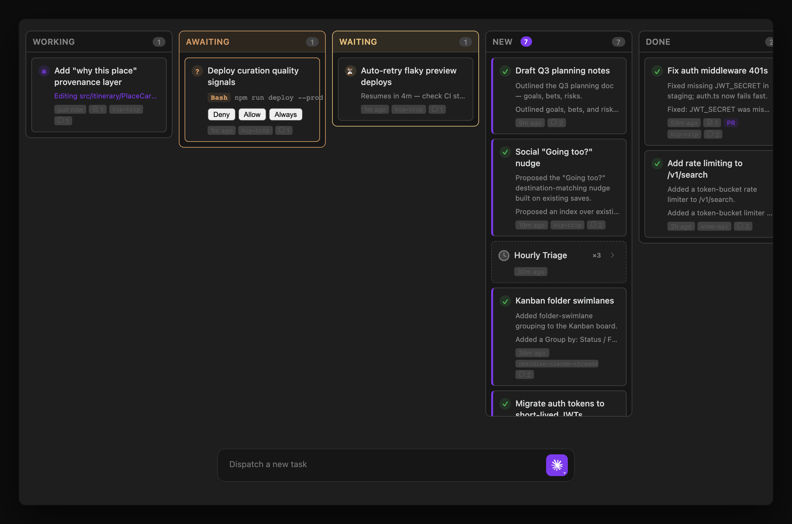
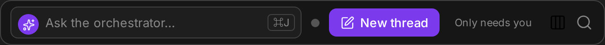
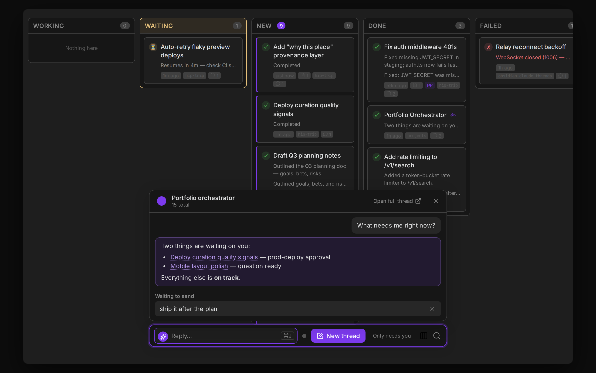
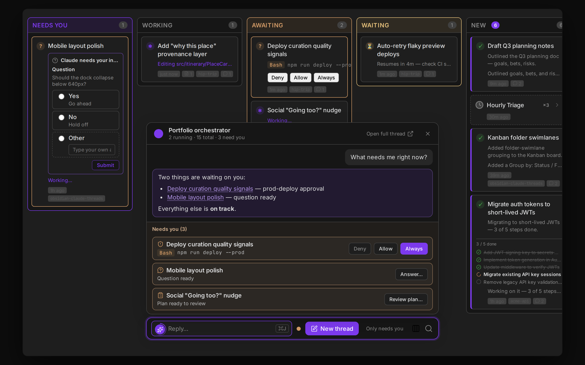
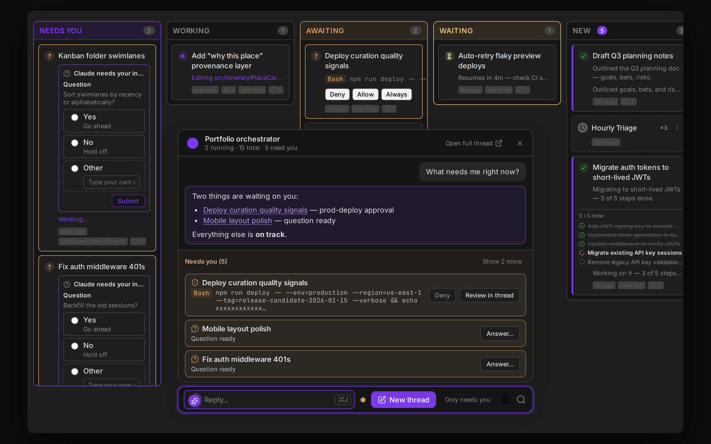
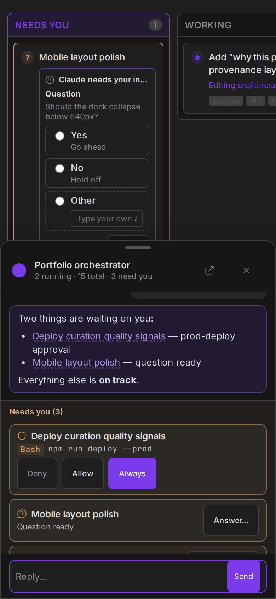
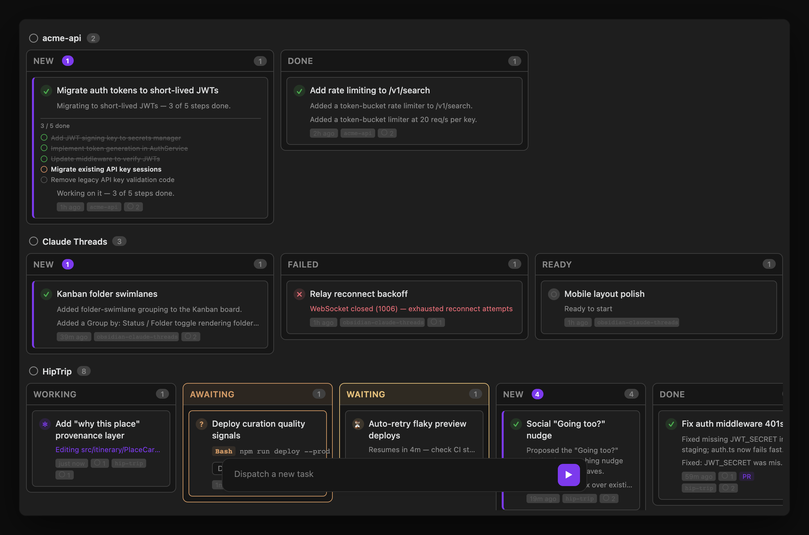
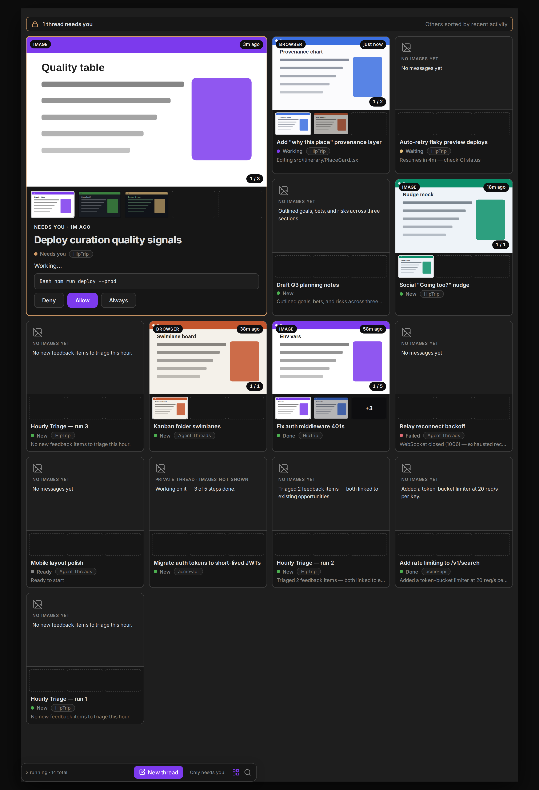

Select the **Agent Board** button in the Agents List toolbar (or run **Open Agent Board** from the command palette) to switch from the default list view to a kanban layout. Each thread is a card, bucketed into a column for its agent state:

| Column | Meaning |
|---|---|
| **Working** | Actively processing a turn — also covers a thread whose own turn has ended but a background subagent (`Agent(..., run_in_background: true)`) or `Workflow` task it spawned hasn't reported back yet, so it doesn't get miscategorized as New/Done/Ready while still doing work server-side |
| **Awaiting** | Waiting on a permission prompt or agent question |
| **Waiting** | A `ScheduleWakeup` is pending — shows a live countdown, e.g. "Resumes in 4m — check CI status" |
| **New** | Unreviewed — completed since you last looked |
| **Done** | Finished and reviewed |
| **Failed** | Ended in an error state |
| **Ready** | Empty — no active work |

Columns are sorted most-recently-active first. The board has its own floating dispatch panel at the bottom — type a task and press Enter to launch a new thread without leaving the board. List view is the default; the preference persists across reloads.

## Dispatching from the board

The kickoff button displays the selected Claude or Codex harness. Press Enter or click it to dispatch; right-click, press and hold, or use its keyboard menu to change the selection without sending. Selection is local to the mounted Agent Board, and Settings supplies only the initial default. See [Agents List → Dispatch box](/docs/views/agent-dashboard/#dispatch-box) for all selector gestures and harness behavior.

The accessible **Project** selector chooses the new thread's Project and initial working directory. **Unassigned** uses the global default cwd. Choose **New Project…** to open Settings → Projects with a blank draft; your current selection is unchanged. The selection survives harness, model, goal, loop, attachment, and image options; [Projects](/docs/integrations/git-and-vault/#projects) documents cwd resolution and reassignment behavior.

The panel accepts the same `/model`, `/goal`, `/loop`, and `/design` prefixes as the Agents List. `/design <brief>` creates a new native design-artifact thread, opens it in Chat, and launches the ArtifactView preview. Bare `/design` shows a usage notice and creates no thread. Image and text attachments are not accepted for design dispatch; Threads preserves the draft so you can remove them and try again. See [Design artifacts in Geode](/docs/core-workflow/messaging-and-commands/#design-artifacts-in-geode) for details.

When a thread owns Claude or Codex child agents, its card also shows a compact native-agent count. Like the Agents List, it is green while any child is starting, working, or waiting, and faint once every run is terminal or unavailable. Open the thread or [Agents List](/docs/views/agent-dashboard/) to inspect the nested team; see [Native Agent Workspace](/docs/views/native-agent-workspace/) for details.

## Ask the portfolio orchestrator

Talk to the [Portfolio Orchestrator](/docs/views/thread-orchestrator/) without leaving the board. The floating pill at the bottom of the board leads with an **Ask the orchestrator…** field, followed by an orb (its ring spins while any thread is running) and a needs-you dot (orange when something is waiting on you). Hover the dot for the counts, for example **2 running · 14 total · 2 need you**; the same line also appears under the reply sheet's title, and on narrow boards the dot carries the needs-you count as a number.

### Ask field and keyboard

Press **Cmd+J** (Ctrl+J on Windows and Linux) while the Agent Board is the active view to focus the field. The shortcut is a normal command named **Ask the portfolio orchestrator**; rebind or clear it under **Settings → Hotkeys**. When the Agent Board is not the active view the key falls through untouched, and it may not fire while a modal is open.

| Key | Action |
|---|---|
| **Enter** | Send |
| **Shift+Enter** | New line |
| **ArrowUp** | Recall your previous message. Works in an empty field, or with the caret at the very start of a one-line draft. Repeat to go further back (the last 20 messages are kept; consecutive duplicates are dropped) |
| **ArrowDown** | Go forward again; it ends on the draft you were typing |
| **Esc** | Close the sheet, or leave the field |

Once you move the caret inside a recalled message, only the very start (Up) or very end (Down) continues the walk, so a long wrapped paragraph keeps normal caret movement. Nothing is recalled while an IME composition is in progress or a send is pending.

**Drafts are kept in memory only.** What you type survives closing and reopening the sheet, the working, error and offline states, switching between narrow and wide layouts, a board refresh, and re-opening the board in the same session. It is never written to disk or to your settings, because a draft can contain a secret, and it is gone when the app quits. A draft belongs to the current orchestrator thread; boards in the same window share it. Drafts are capped at 4,000 characters, and a message that fails to send is put back in the field.

### The reply sheet

**Enter** sends your message to the Portfolio Orchestrator and opens a reply sheet above the pill. The sheet stays open when you click the board and is never opened automatically.

- **Conversation.** Replies render as markdown and appear as they stream in, with the orchestrator's current activity shown while it works.
- **Stop.** While the orchestrator is working, **Stop** replaces Send and interrupts the turn.
- **Sent, will be picked up.** A message you send while the orchestrator is busy is picked up by the turn in progress and marked **Sent, will be picked up**.
- **Waiting to send.** Anything the manager is holding back, for example while a plan awaits your decision, is listed under **Waiting to send** with a remove button.
- **Same rendering as the conversation panel.** Messages use the same renderer as the main conversation: markdown, tables and code, notices, compaction dividers, clickable URLs in your messages and local image thumbnails. Tool calls appear as one collapsed **N tool calls** row per message that expands in place. Remote images are never loaded: a remote markdown image shows as a text link instead.
- **Last 50 messages.** The sheet draws the most recent 50 messages. When there are older ones, a **Showing last 50 messages** row at the top opens the full thread.
- **Open full thread.** Plans, questions and visualizations are not rendered in the sheet; plans and questions hand off to the thread, and a visualization shows an **Open full thread ↗** chip.
- **Unread peek.** With the sheet closed, a new reply shows a one-line peek above the pill for about 8 seconds and keeps the dot lit until you open the sheet.
- **Suggestion chips.** With an empty conversation, focusing the field offers suggested prompts.

### Thread links

When the orchestrator names a thread, the sheet shows it as a link. Hover (or keyboard-focus) the link and that thread's card on the board is highlighted and scrolled into view; click it to open the thread. The sheet stays open. If your system asks for reduced motion, the card scrolls instantly with no flash.

Links need a Threads Orchestrator plugin version that writes `[[thread:<id>|Title]]` markers (threads-orchestrator PR #21). With an older version the orchestrator names threads by plain title, so there is nothing to hover or click.

### The Needs you tray

A **Needs you (N)** tray above the composer lists every thread waiting on you, including the orchestrator's own, and collapses to **Show N more** beyond three. Permission requests are listed first.

- **Permission requests** show the same **Deny**, **Allow** and **Always** buttons as the thread's board card. Resolving one in the sheet or on the board resolves both. Each click is checked against the request that is pending now, so a stale card cannot approve the next request.
- **Not approvable inline.** Allow and **Always** are offered only when the request is small enough to be read in full: a single field (a command, a path, a URL) that is not cut off and has no line breaks. A request with several fields, or a long or multi-line detail, keeps only **Deny** and a **Review in thread** button, so nothing is approved blind.
- **Questions and plans** are never answered inline. They show a single **Answer…** or **Review plan…** button that opens the thread.

### States

| State | What you see |
|---|---|
| First run | No orchestrator exists yet: the field reads "No orchestrator yet" and becomes a **Set up…** button |
| Working | The orb ring spins; the sheet shows activity and **Stop** |
| Needs you | The dot turns orange (or stays lit for an unread reply) |
| Error | The orchestrator's error reason, with **Open thread** |
| Offline | "daemon disconnected", with **Reconnect** |

### Narrow boards and phones

Under 640px wide the pill collapses to the orb plus **New thread**, and the sheet becomes a bottom sheet with 44px touch targets that respects the device safe area and lifts above the on-screen keyboard.

### Accessibility and motion

- Screen readers hear a short announcement when the orchestrator errors, goes offline or recovers (not on every refresh), when a reply streams in or finishes, and when new Needs you items appear.
- The dot has a text label with the counts, and the same counts are shown as visible text in the sheet header, so touch users do not depend on the hover tooltip.
- With reduced motion enabled, the orb and activity animations, the pill transition and the card flash are switched off, and the highlighted card scrolls instantly.

## Task list on cards

When a thread has an active Claude `TodoWrite` / `TaskCreate` checklist or Codex `update_plan` checklist, its Agent Board card shows a compact task list: up to 5 items with status icons (✔ completed, ■ in-progress, ○ pending), a "X / Y done" progress line, and "+N more" when there are additional tasks. The list updates live as the agent ticks items off — useful for seeing exactly how far along a long-running task is without opening the conversation.

## Group by folder, project or gallery

The group-by toggle in the board header (the icon next to search) cycles through four layouts: **status columns** (the default), **folder swimlanes**, **project columns**, and **gallery**. Each click advances to the next; the choice persists across reloads.

### Folder swimlanes

One horizontal lane per app/project, so you can see every conversation for a given codebase together. An explicitly assigned [Project](/docs/integrations/git-and-vault/#projects) always wins. For an unassigned thread, the board resolves its origin repository or effective working directory; when that root matches a configured Project's effective root, the thread joins that Project's lane. Otherwise it falls back to the git repository name or working-directory label, and an **Unassigned** lane catches threads with no folder. Inside each lane the cards are still grouped into the same status columns (empty columns are hidden to keep lanes compact). Lanes are ordered alphabetically (case-insensitive), with Unassigned pinned last.

### Project columns

One vertical column per app/project (same project resolution as folder swimlanes — alphabetical, Unassigned last), with each column's cards grouped under status **section headers**: Working, Waiting, New, Reviewed, Failed, Ready. This mirrors the Agents List sidebar's grouping — awaiting-permission threads fold into **Working**, and empty sections are omitted. Each column reads top-to-bottom like a compact per-project dashboard. Columns are a fixed 300px wide; when there are more than fit, the board scrolls horizontally, and each column scrolls vertically on its own. With a mouse, the wheel scrolls a column while it can still scroll in that direction and otherwise moves the board sideways (Shift+wheel and trackpad swipes also work).

### Gallery

Gallery (desktop and Geode only) shows one larger card per thread, built around what the agent actually produced:

- **Hero image.** The thread's newest visual, with a source badge — **Browser** for an image from a `browser_screenshot` call, **Image** for any other tool-result image — and its age.
- **Filmstrip.** Up to 3 thumbnails (4 when the board is one column wide, 5 on a featured card) with a "+N" slot when there are more. Use the previous/next arrows, click a thumbnail, or focus the hero and press the left/right arrow keys to step through the thread's images (newest 50). A live "n / m" counter shows your position.
- **Needs you.** Threads waiting on you, including pending permission prompts, become large featured cards with **Allow**, **Deny** and **Always** buttons that behave like the Needs-you lane on the status board. The rest sit in a grid sorted by recent activity. The search box and **Only needs you** filter apply to the gallery too.
- **Text placeholder cards.** A thread with no images — a brand-new thread, one whose images were never saved, a Codex, OpenCode or Replay thread (these don't produce tool-result images), or any **private** thread — gets a same-size text card with its last message, so every thread stays visible.

Only images returned by tool results appear: screenshots, a `Read` of a picture, and so on. Images you attached yourself and the in-app browser's live frame are never shown. When an image is saved, a small 160px WebP thumbnail is written next to it; older images get theirs the first time their card scrolls into view. A new message or screenshot refreshes just that thread's card. Mobile and relay clients don't receive tool-result images, so Gallery isn't available there.

## Stacked scheduled-job threads

Repeat runs of the same [scheduled task](/docs/automation/scheduled-tasks/) pile up fast — an hourly triage job produces ~24 cards a day, crowding out the threads you started yourself. In the quiet columns only (**New**, **Done**/**Reviewed**, **Ready** — a run that's Working, Awaiting, Waiting, or Failed always stays its own card), runs that share a scheduled job collapse into a single dashed-border rollup card: job name, a "×N" run count, and the latest run's time. Click the card to expand it into the individual run cards, indented beneath. This applies in status-column, folder-swimlane, and project-column mode.

Enabled by default — disable via **Settings → Features → Agent Board → Stack scheduled job threads** if you'd rather see every run as its own card, see [Settings Reference → Features](/docs/reference/settings/#kanban-board).

## Archive from a card (right-click)

Cards carry the same right-click **Archive thread** action as Agents List rows, including the bulk archive for stacked scheduled-job runs — right-click the stack card's header row for **Archive these N runs**, plus **Archive all M runs of this job** when that job has runs the card isn't showing. Desktop only. See [Agents List → Archive from the list](/docs/views/agent-dashboard/#archive-from-the-list-right-click) for the confirmation rules and full behavior.

## Auto-collapse side panels

Set **Settings → Features → Agent Board → Auto-collapse side panel** to `Left sidebar`, `Right sidebar`, or `Both sidebars` to automatically collapse Obsidian's sidebar panel(s) when the Agent Board tab opens, giving the board more horizontal room. Only the panel(s) the Agent Board collapsed are restored when you close the tab, so it won't fight a panel you collapsed or expanded manually. Defaults to `None` (opt-in) — see [Settings Reference → Features](/docs/reference/settings/#features).
